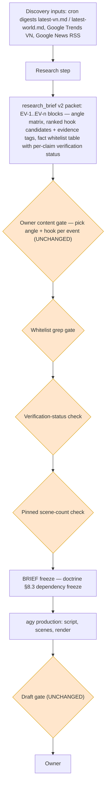

# Research-Step Upgrade Analysis — agy/Argon fit, Multi-Angle, Hook Attractiveness

Date: 2026-11-21 · Scope: ANALYSIS ONLY (read-only on all inputs; single deliverable file)
Evidence base: `~/.hermes/skills/devops/news-video-pipeline/SKILL.md`, `docs/ORCHESTRATION_DOCTRINE.md`, projects `tin-nong-5tin-20261120`, `tin-nong-4tin-20261119`, `tin-nong-5tin-thue-20261118`, `gold-giam-sau-20261120`, cron digests `~/.hermes/cron/output/news-daily/latest-vn.md` / `latest-world.md`.

---

## 1. Final Recommendation Summary

The research step's **verification discipline is already strong** (fetch-level evidence, CORROBORATED multi-source, PENDING blocking, discrepancy exclusion — all working in the four sampled episodes); what is weak is the **shape of its output packet**. Today `research_brief.md` is prose: numbers embedded in timeline paragraphs, whitelists split across three surfaces (`research_brief.md` timeline prose, `BRIEF.md` block prose, `BRIEF.md` pin list), one implicit angle per event, hook candidates living only in chat clarify. This directly caused the observed agy failures: shipped display strings (`21 triệu`, `25.920`) missing from the 20/11 pin list, an unpinned "~13–15 cảnh" scene range that nothing downstream could machine-check, and hook/angle defaults applied unopposed when owner clarify questions timed out. **Recommendation: keep verification policy 100% unchanged; restructure the packet into a `research_brief` v2 schema with (1) a per-event multi-angle matrix, (2) ranked evidence-tagged hook candidates with a scored rubric, (3) a single machine-greppable fact whitelist table where every row pins the exact display string, its verification status, and its allowed scenes — so every number that reaches a scene must reference a fact row.** The `gold-giam-sau-20261120` brief already does the whitelist half of this ("Số ngoài các chuỗi trên = FAIL (whitelist leak)"); generalize it, add the angle/hook half, and make the owner content gate a per-event pick from ranked options instead of a timed-out default.

---

## 2. Current-State Diagnosis of the Research Step

### 2.1 What the research step produces today

Per `SKILL.md`, the research step owns the news domain: Daily Intelligence Discovery (cron digests first, then Google News RSS / Trends), the evidence-fetch sequence (discover publisher URLs → fetch original article bodies → validate title/date/text before whitelist entry), the `SELECTION = ẤN TƯỞNG TRƯỚC TIÊN` mandate (4–5 strongest-impact stories ranked descending), the `NHẬN ĐỊNH` commentary layer, and the deep-dive brief artifact. The concrete artifact is `research/research_brief.md` + `research/evidence/ev*.md`, followed by a lead-written `BRIEF.md` production brief that freezes facts per doctrine `ORCHESTRATION_DOCTRINE.md` §8.1 phase 1 ("Brief/Script/Facts — brief/script + facts được chốt và freeze… facts có nguồn, không bịa").

Structure of today's briefs (evidence):

| Episode | Brief length | Whitelist form | Angles per event | Hooks in artifact |
|---|---|---|---|---|
| `tin-nong-5tin-thue-20261118` | 75 lines | Pin list as prose sentence ("pin đúng chuỗi format renderer in: `15,5 triệu`, `6,2 triệu`, …") | 1 implicit | No — approved in clarify |
| `tin-nong-4tin-20261119` | 90 lines | Per-topic prose blocks, one pinned ("display pin đúng chuỗi") | 1 implicit | No — hook in PRODUCTION-REPORT only |
| `tin-nong-5tin-20261120` | 35 lines | Timeline prose + separate pin list in `BRIEF.md` | 1 implicit (bundle framing) | 3 in checkpoint, unranked, bundle-level |
| `gold-giam-sau-20261120` | 38 lines | **Machine-pinned table + FAIL rule** | 1 (deep-dive) | Hook 1/2/3 offered in clarify chat only |

### 2.2 Where it is thin

**(a) Single implicit angle per event.** No brief records alternative angles. The only angle structure anywhere is `history/checkpoint_research_20261120T0257360165500000.json` → `angles_discovered`, and those 3 entries are *bundle-level framings* ("Điểm tin 5 tin nóng chạm ví tiền 20/11", "Chart A/B vàng bạc đáy 12 tháng & dự thảo giảm 85% phạt MST", "Cảnh báo an toàn giao thông & quyền khởi kiện hội viên") — not per-event angle matrices, and each carries exactly one hook with no ranking.

**(b) Hook ranking is ad hoc, done by the lead in chat.** `gold-giam-sau-20261120/decision_log.json` d-001 records approval as "Duyệt gói + Hook 2 (vàng giảm gần 9%/tuần)" — hook options existed only in the clarify conversation, not in any artifact with scores or evidence tags. For `tin-nong-5tin-20261120`, `APPROVAL_content.md` line 5 records that Q2 (topic choice) and Q3 (hook) **timed out** ("Q2 (chọn tin) + Q3 (hook) → **timed_out** … áp dụng mặc định ĐÃ TRÌNH … + hook H1 (Recommended)") — the shipped hook was a chat-timeout fallback, not an owner decision made from ranked options. This is exactly the failure mode objective 3 targets.

**(c) Format is not machine-checkable; whitelists are split across surfaces.** In `tin-nong-5tin-20261120`, numbers live in three places: `research/research_brief.md` §Timeline (prose, e.g. "20/11 SJC 133,2–136,2 (PNJ/DOJI/Phú Quý; BTMC mua 131,8)"), `BRIEF.md` block prose, and `BRIEF.md` §Fact whitelist pin list. The three surfaces disagree in coverage (see §3 F-1). Contrast with `gold-giam-sau-20261120/BRIEF.md` §Fact whitelist, which pins quoted strings in a closed list with "Số ngoài các chuỗi trên = FAIL (whitelist leak)" — the right idea, but it exists in only 1 of 4 sampled projects and still lacks per-claim verification status, scene assignment, and narration (spoken) forms.

**(d) Per-claim verification status is inherited, not per-row.** `tin-nong-5tin-thue-20261118/research/research_brief.md` line 63: "Sources whitelist (tất cả CORROBORATED trừ khi ghi khác)" — a default-inherited status over 12 evidence files, with an explicit note (line 6) that PRIMARY upgrade via `vanban.chinhphu.vn` was available but not taken. The exceptions (voz "pulse only, không dùng làm fact", DỰ THẢO labels) are prose footnotes, not machine-checkable fields.

**(e) Scene structure is a prose range, not a pinned value.** `tin-nong-5tin-20261120/research/research_brief.md` line 34: "Episode structure (13–15 cảnh, S1 hook Tin 1)" — a range. Production shipped 13 scenes (`scene_index_tin-nong-5tin-20261120.md`), and the minted wrapper had hardcoded 14/15-scene expectations (see §3 F-2). Nothing in the packet could mechanically catch the mismatch.

**(f) Discovery inputs are thin one-liners.** `latest-vn.md` / `latest-world.md` are category-grouped one-line bullets with no URL, no `pubDate`, no per-item scale anchor — e.g. `latest-vn.md` line 10: "**Giá vàng thế giới về sát mốc 3.500 USD/ounce** — giá bạc trong nước cũng giảm mạnh khoảng nửa triệu đồng/kg." `SKILL.md` itself (line 40) mandates treating these as leads, not facts ("Treat cron claims as leads, not facts"), so the research step must re-derive everything downstream — fine for safety, but the digest could cheaply carry structured fields (URL, date, source, candidate angle) to shorten discovery.

**(g) No cross-episode number consistency check.** On the same day 20/11, two episodes shipped different SJC print figures from different publishers/hours: `tin-nong-5tin-20261120/research/research_brief.md` line 15 "20/11 SJC 133,2–136,2 (PNJ/DOJI/Phú Quý; BTMC mua 131,8)" vs `gold-giam-sau-20261120/research/research_brief.md` line 24 "SJC mua 129,2/bán 134,2 triệu/lượng". Both are legitimately sourced, but the SKILL dedup rule (line 37) only covers hook + event overlap across sibling episodes — not number consistency — so a viewer watching both videos sees two different "today's SJC price" numbers with no reconciling note.

### 2.3 What is already strong (do not touch)

- **Verification-before-whitelist works**: `tin-nong-4tin-20261119/research/research_brief.md` excluded a VnExpress E5 price as DISCREPANCY ("VnExpress … Search snippet ghi 18.670, trái với công văn ký + Thanh Niên + PetroTimes; E10 khớp") and handled the 15:00 same-day price decision as PENDING-then-resolved ("Fact whitelist — quyết định công bố 15:00 hôm nay (display pin đúng chuỗi)").
- **Freshness traps are flagged**: `tin-nong-4tin-20261119/research/research_brief.md` line 83: "⚠️ FRESHNESS: Google 18/11, Microsoft 17/11 → narration 'trong 2 ngày qua', KHÔNG nói 'hôm nay'" — shipped correctly (`PRODUCTION-REPORT.md` §3 Fact whitelist: "freshness 'trong 2 ngày qua'").
- **Nuance guards are enforced in output**: all four PRODUCTION-REPORTs carry the mandatory nuance items (DỰ THẢO, `[tính toán]`, nhân-chứng-vs-đang-làm-rõ, DXY≠tỷ giá, vendor-claim attribution).
- **Gate integrity**: content approval, fact verification, whitelist discipline all held in every episode (§8.1/§8.2 strict semantics, editorial-language gate PASS in all four).

---

## 3. Failure-Mode Inventory (agy errors / wasted effort → research-packet gap)

| # | Episode | What happened (evidence) | Research-packet gap |
|---|---|---|---|
| F-1 | `tin-nong-5tin-20261120` | Numbers shipped in the video are absent from the pin list: scene-4 narration "SJC cao hơn thế giới ~21 tr/lượng" (`scene_index_tin-nong-5tin-20261120.md` line 10) and scene-10 "VCB 25.920" (`scene_index…` line 16; `PRODUCTION-REPORT.md` §3 item 4) — but `BRIEF.md` §Fact whitelist pin list (line 47) contains neither `21 triệu` nor `25.920` (only `25.646`, `25.940`); both numbers exist only in `research/research_brief.md` §Timeline prose (line 15: "vàng TG 3.627 USD/oz") + `BRIEF.md` block prose (line 39: "vàng TG quy đổi thấp hơn ~21 triệu/lượng"; checkpoint `used_for`: "chênh 21 tr") and (line 18: "VCB 25.510–25.920"). Whitelist discipline held only because agy cross-read three files correctly. | Whitelist split across 3 surfaces; no single closed fact table binding display string → scenes. The exact "wrong whitelisted strings" class objective 1 names. |
| F-2 | `tin-nong-5tin-20261120` | Minted pipeline wrappers had structural mismatch and had to be bypassed: `agy_dispatch.log` line 29 issues — "scripts/cc_pipeline wrappers had structural mismatch (y460-1220 vs SceneShell y360-1050, scene/ vs scenes/, 14/15 hardcoded); authored S01..S13 directly by agy"; same note in `PRODUCTION-REPORT.md` §2 Note. Brief only said "~13–15 cảnh" (`BRIEF.md` line 31). | Scene count and structure expressed as a prose range, not a pinned machine value; packet had no exact scene manifest for the wrapper mint to consume. (The wrapper hardcode is a pipeline-mint defect; the packet gap is that nothing in the brief could catch it early.) |
| F-3 | `tin-nong-5tin-20261120` | Hook H1 + topic order applied as timeout default, not owner choice: `APPROVAL_content.md` line 5 — "Q2 (chọn tin) + Q3 (hook) → **timed_out** … áp dụng mặc định … + hook H1 (Recommended)". | No ranked hook matrix in the artifact for the owner to pick from cheaply; the "recommended" hook was chat-only. |
| F-4 | `tin-nong-4tin-20261119` | Highest revision churn of the sample: `editorial_language_gate` `revise=12` (`PRODUCTION-REPORT.md` §3, vs `revise=1` in `tin-nong-5tin-thue-20261118/PRODUCTION-REPORT.md` §3 and `tin-nong-5tin-20261120/PRODUCTION-REPORT.md` §3) — on the brief with the largest unpinned number surface (~40 figures across 4 topics incl. vendor benchmarks with attribution obligations, `research/research_brief.md` lines 15–82). Correlation, not proven causation — but consistent with writers having to re-derive fact placement from prose. | Fact table absent; no per-scene fact assignment; attribution labels (vendor claim, `[tính toán]`, freshness) carried as prose QA flags instead of per-fact fields. |
| F-5 | `tin-nong-4tin-20261119` | Unstable topic IDs: a 4-topic episode whose brief numbers topics "Tin 1", "Tin 2", "Tin 3", then "### Tin 8 — AI 2 ngày lớn" (`research/research_brief.md` line 62) — artifact of incremental editing. | No canonical topic/event ID scheme; downstream references (`ev8-gemini4neon-google.md`) inherit the unstable numbering. |
| F-6 | `tin-nong-4tin-20261119` | agy re-generated TTS for 3 segments mid-run: `agy_dispatch.log` line 5 — "Đang tái sinh TTS cho 3 đoạn tinh chỉnh (`s4`, `s12`, `s13`) và chạy lại Whisper word alignment". These were number-dense segments (gas-price list; Gemini/Microsoft pricing). | Narration-format constraints (`Số ≥2 chữ số viết dạng chữ trong provider_text`, "≤3 số/câu") exist only in `tin-nong-5tin-20261120/BRIEF.md` line 52 — absent from the 19/11 packet; the 19/11 narration_form was left to agy to guess per segment. |
| F-7 | `tin-nong-5tin-thue-20261118` | The shipped hook itself rests on a calculation with a condition: hook "Lương 15 triệu một tháng: từ nay bạn không còn phải nộp thuế thu nhập cá nhân…" (`PRODUCTION-REPORT.md` §1) required the guard "gắn nhãn `TÍNH TOÁN · CHỈ TÍNH LƯƠNG`" plus 5 more nuance guards to stay honest (`PRODUCTION-REPORT.md` §3 item 1–6). Hook attractiveness was maximized with no recorded fragility assessment. | Hook candidates carried no risk/evidence-strength scoring; research never recorded "this hook is the most fragile, prefer at cost of X". |
| F-8 | `tin-nong-5tin-thue-20261118` | Evidence-level handling flat: 12 sources inherited "tất cả CORROBORATED trừ khi ghi khác" (brief line 63) with an unused PRIMARY upgrade path (line 6: "Nếu production cần nâng PRIMARY tuyệt đối cho số load-bearing: fetch văn bản gốc tại vanban.chinhphu.vn …"); voz listed as pulse-only in prose. | Verification status is a table-wide default + prose exceptions, not a per-claim column — agy cannot grep "is THIS number verified at what level". |
| F-9 | `gold-giam-sau-20261120` | Hook chosen as "Hook 2" from clarify options only (`decision_log.json` d-001); the research brief was written after angle/hook selection, so it documents the chosen angle ("Vì sao vàng giảm sâu?" — mechanism-first) but no alternatives (e.g. personal-loss-first with the `129,2/134,2` + `~3,7%` round-trip-loss frame, or affected-people-first with `512 triệu USD` North-America ETF outflow). | No angle matrix; alternatives unrecorded, so the owner's pick had no paper trail and no comparability. |
| F-10 | cross-episode (20/11) | Same-day sibling episodes print different SJC figures without reconciliation: `133,2–136,2` (bundle, PNJ/DOJI/Phú Quý) vs `129,2/134,2` (deep-dive, VOV) — both legitimately sourced (§2.2g). | Discovery/dedup step has no cross-episode number-consistency or shared-number note requirement. |

**Not research-attributable (recorded for honesty, excluded from gap-tracing):** `s12_member_rights` image fell back to `9router/cx/gpt-5.6-luna-image` after `agy gemini-3.1-flash-image hit 429 quota` (`agy_dispatch.log` line 29) — provider quota, not packet; S03/S09/S13 layout fixes and the AAC True-Peak ceiling fix (`agy_dispatch.log` lines 6/8; `tin-nong-4tin-20261119/agy_dispatch.log` line 8) — visual/mastering, not packet.

---

## 4. Upgrade Proposal — `research_brief` v2 schema

**Policy invariant:** this proposal changes **format and coverage only**. All mandatory gates stay intact and untouched: content approval (owner clarify/draft gates), fact verification (evidence-fetch sequence, CORROBORATED multi-source, PENDING-dispatch blocking per `SKILL.md` line 42, discrepancy exclusion), whitelist discipline, doctrine §8.1–§8.3 freeze/strict semantics, publication separation §8.4.

### 4.1 Packet structure (one file, machine-greppable)

```yaml
# research_brief.md v2 — front-matter block (rendered as a YAML/JSON block + human sections)
packet_version: 2
packet_date: 2026-11-20
discovery_inputs: [cron/latest-vn.md, cron/latest-world.md, google_trends_vn, google_news_rss]
freshness_anchor: "2026-11-20"          # every relative date resolved against this
episode_format: bundle5 | deepdive      # pinned
scene_count_exact: 13                   # pinned integer — kills the "13–15" range class (F-2)
evidence_dir: research/evidence/        # ev01..ev10
```

### 4.2 Per-event block `EV-<n>` (stable IDs — kills the "Tin 8" class, F-5)

For each event, one block with five sub-sections:

1. **`claim_core`** — one sentence, sourced.
2. **`angle_matrix`** — the multi-angle objective. Five standard rows, each: premise line + supporting `fact_id`s + `saturation` note (is this angle already burned by sibling episodes?) + `recommend` flag. Angles: `macro-policy`, `personal-money`, `mechanism-cause`, `timeline`, `affected-people`. Bundle episodes fill the matrix too — the *block order* is then chosen by the strongest recommended angle per event (matches `SELECTION = ẤN TƯỞNG TRƯỚC TIÊN`, which stays the ranking law).
3. **`hook_candidates`** — 2–3 ranked hooks (see §4.4 scoring), each with `evidence_tags` (`[EV-1#f03]` style) and `risk_flag` (which nuance guard the hook stresses most).
4. **`fact_table`** — the single machine-greppable whitelist (see §4.3). **This is the only number surface in the packet.** Timeline prose is replaced by the table's `context` fields.
5. **`nuance_guards` + `banned_strings`** — per-fact mandatory labels, plus numbers explicitly banned from narration (e.g. a rival publisher's discrepant figure), so exclusion is greppable too.

### 4.3 Fact table row schema (the core fix for F-1/F-4/F-8)

```markdown
| fact_id | display_string (PIN — renderer prints exactly this) | type | source | verification | allowed_scenes | narration_form |
|---|---|---|---|---|---|---|
| EV-1#f01 | `136,2` | source | ev01 (1thegioi 20/11) | CORROBORATED | S2,S3 | "một trăm ba mươi sáu phẩy hai" |
| EV-1#f07 | `55,1 triệu` | calculated (191,3−136,2) | ev01+ev02 | CALCULATED | S3 | — |
| EV-1#f08 | `58 triệu` | source (gồm chênh mua-bán 3–4,4 tr) | ev01 · badge 1thegioi | CORROBORATED+ATTR | S1,S3 | "gần năm mươi tám triệu" |
| EV-2#f01 | `15%` | source | ev05 | CORROBORATED · DỰ THẢO | S5,S6 | — |
```

- `verification` vocabulary (per claim, never table-wide): `PRIMARY_FETCHED` / `CORROBORATED` / `CORROBORATED+ATTR` (vendor/benchmark claim — "theo công bố của Microsoft") / `CALCULATED` (needs `[tính toán]` label) / `DISCREPANCY-EXCLUDED` (move to `banned_strings`) / `PENDING(deadline)` (dispatch-blocked per existing `SKILL.md` rule — unchanged) / `PULSE_ONLY` (never a fact).
- **Machine check (new, mechanical, mirrors existing grep-gate style):** after scene authoring, grep every scene's printed strings against `fact_table.display_string`; any printed number not present in an `allowed_scenes` row for that scene = FAIL, same fail-closed semantics as `editorial_language_gate`. This makes F-1 structurally impossible: `21 triệu` and `25.920` either have rows with `allowed_scenes: S4`/`S10` — or cannot be printed.
- `narration_form` carries the spoken variant (e.g. `"gần năm mươi tám triệu"`, matching `APPROVAL_content.md` line 17 provider_text "gần năm mươi tám triệu đồng một lượng") so agy never re-derives TTS formatting per segment — addresses F-6.

### 4.4 Hook scoring rubric (objective 3)

Each hook candidate scored 0–5 on five evidence-grounded dimensions + one penalty. **Every score must cite `fact_id`s; a dimension with no supporting fact row scores 0 — no clickbait inflation by construction.**

| Dimension | Question | Anchor example (EV-1, 20/11) |
|---|---|---|
| `scale` | Is there a magnitude anchor a commuter can feel in 1 second? | `191,3 → 136,2` = `55,1 triệu`/lượng (f01+f07) |
| `personal-stakes` | "What does this mean for YOU" — wallet/salary/time of 25–35 đi làm? | người mua đỉnh lỗ `gần 58 triệu`/lượng; case `433 triệu` (f08, f10) |
| `shock/novelty` | Sudden decision, first-ever, lowest-since? | đáy 12 tháng; bạc thấp nhất từ 9/2025 (f02, f04) |
| `contrast` | Before/after or expectation-vs-reality? | "tài sản trú ẩn" đang bị bán (gold-giam-sau hook pattern) |
| `relatability` | Affected-people story with names/amounts? | anh Hoàng `675 triệu` → lỗ `~433 triệu`; chị Nhật Minh lỗ gần `100 triệu` (f10, f11) |
| − `fragility_penalty` | −1 to −3 when the hook's load-bearing number is CALCULATED-only, PENDING, DỰ THẢO, or needs heavy attribution | "lỗ gần 58 triệu" = −1 (gồm chênh mua-bán, needs 1thegioi badge) |

Hook `risk_flag` then names the guard to print (e.g. "58 triệu → badge 1thegioi + 'gồm chênh mua-bán'"). The `fragility_penalty` is what F-7 lacked: the 18/11 hook ("Lương 15 triệu… không còn phải nộp thuế") would have scored max on personal-stakes but carried a −2 fragility penalty (CALCULATED + condition "chỉ tính lương"), making the trade-off explicit for the owner instead of discovered during production.

### 4.5 Discovery improvements (coverage, not policy)

1. **Digest row schema**: upgrade `latest-vn.md` / `latest-world.md` bullets to carry `url`, `pubDate`, `source`, `candidate_angle`, `scale_anchor` per item. Research still re-verifies everything (unchanged — `SKILL.md` line 40 "Treat cron claims as leads, not facts" stays law); structured rows just cut re-discovery turns.
2. **Trend/digest intake as data**: today's briefs record Google-Trends volumes in prose ("Google Trends VN 20/11 (top: thuế 2000+, giá bạc Phú Quý 200+…)", `tin-nong-5tin-20261120/research/research_brief.md` line 3). Make it a `selection_intake` list (candidate, trend_volume, rss_hits, digest_mentions, freshness) so the impression ranking is checkable.
3. **Cross-episode number note (fixes F-10)**: when a sibling episode within 48h already shipped numbers for the same metric, the new packet must include a `sibling_consistency` field: either reuse the shipped string, or print both with time/source qualifiers. (SKILL dedup rule stays; this extends it from hook/event to numbers.)
4. **Owner content gate consumes the matrix**: clarify Q2/Q3 present, per event, the ranked angles + hooks straight from the packet — so a timeout falls back to the *highest-scored* option with the score table already on record (fixes F-3; `decision_log.json` gains `options_considered` entries that are currently empty arrays in all sampled projects).

### 4.6 Upgraded flow



G1 (content approval), G3 (fact verification policy), G2 (whitelist discipline) are the existing mandatory gates — unchanged in authority; G2/G4 are new *mechanical checkers over the packet format*, not new policy.

---

## 5. Worked Example — `EV-1` of `tin-nong-5tin-20261120` (vàng bạc đáy 12 tháng)

Every fact below is present in the shipped packets (`research/research_brief.md` lines 8/15, `BRIEF.md` lines 39/47, `history/checkpoint_research_…json`). No invented numbers. Strings shipped but missing from the old pin list (`21 triệu`, `25.920`) are shown how the v2 schema pins them properly (§3 F-1).

```yaml
- event_id: EV-1
  slug: vang-bac-day-12-thang
  claim_core: >
    Vàng SJC về đáy 12 tháng ngày 20/11 (133,2–136,2 triệu/lượng bán ra tại
    PNJ/DOJI/Phú Quý), bạc Phú Quý mất 2/3 giá trị từ đỉnh; người mua đỉnh lỗ nặng.

  angle_matrix:
    - angle: personal-money
      premise: "Người mua đỉnh lỗ gần 58 triệu đồng một lượng; case thật lỗ hàng trăm triệu."
      facts: [EV-1#f08, EV-1#f10, EV-1#f11]
      saturation: "1thegioi đã chạy góc này — phải tách bạch 55,1 (thuần) vs 58 (gồm chênh)"
      recommend: true          # strongest for 25–35 commuters
    - angle: mechanism-cause
      premise: "USD mạnh + lợi suất trái phiếu tăng ép vàng (các bài nguồn quy cho nguyên nhân này)."
      facts: [EV-1#f12]
      saturation: "low — để dành cho deep-dive gold-giam-sau cùng ngày"
      recommend: false
    - angle: macro-policy
      premise: "(không dùng — EV-1 là tin thị trường; macro nằm ở EV-4 USD)"
      facts: []
      recommend: false
    - angle: timeline
      premise: "Đỉnh 29/1 191,3 → giảm liên tục 17–20/11 → đáy 12 tháng."
      facts: [EV-1#f01, EV-1#f02, EV-1#f03]
      recommend: false
    - angle: affected-people
      premise: "Ai đang giữ nhẫn/vàng tất toán lúc đáy: tính chênh mua-bán 3–4,4 tr trước khi bán."
      facts: [EV-1#f06, EV-1#f08]
      recommend: false         # dùng làm NHẬN ĐỊNH, không làm angle chính

  hook_candidates:              # ranked by rubric §4.4
    - rank: 1
      text: "Giá vàng rớt về đáy một năm: người mua đỉnh lỗ gần 58 triệu đồng một lượng — và đây mới chỉ là tin đầu tiên trong 5 tin nóng chạm ví tiền hôm nay."
      scores: {scale: 5, personal: 5, shock: 4, contrast: 3, relatability: 4, fragility: -1}
      net: 20
      evidence_tags: [EV-1#f01, EV-1#f03, EV-1#f08]
      risk_flag: "'58 triệu' gồm chênh mua-bán 3–4,4 tr → badge 1thegioi + 'gồm chênh mua-bán' (nuance 2 hiện hành)"
    - rank: 2
      text: "Bạc Phú Quý mất 2/3 giá trị từ đỉnh hơn 121 triệu xuống 38,319 triệu một kilogram."
      scores: {scale: 5, personal: 3, shock: 4, contrast: 5, relatability: 2, fragility: 0}
      net: 19
      evidence_tags: [EV-1#f04, EV-1#f05]
      risk_flag: "'mất 2/3' là label đã có trong BRIEF; giữ mốc đỉnh 'hơn 121 triệu' và mức 38,319 triệu/kg, không thêm thời lượng chưa pin"
    - rank: 3
      text: "Người mua đỉnh 29/1 lỗ gần 58 triệu một lượng — nhưng chị Nhật Minh chỉ mua 2 lượng nhẫn 370 triệu vẫn lỗ gần 100 triệu."
      scores: {scale: 4, personal: 5, shock: 3, contrast: 3, relatability: 5, fragility: -1}
      net: 19
      evidence_tags: [EV-1#f03, EV-1#f08, EV-1#f11]
      risk_flag: "case Dân trí 12/11 — nói rõ thời điểm case, không ghép giá 20/11"

  fact_table:
    - {id: EV-1#f01, display: "133,2–136,2", type: source, source: "ev01 1thegioi 20/11 + ev03 thuongtruong 20/11", verification: CORROBORATED, allowed_scenes: [S2], narration: "một trăm ba mươi sáu phẩy hai"}
    - {id: EV-1#f02, display: "191,3", type: source, source: "ev01 (đỉnh 29/1 bán ra)", verification: CORROBORATED, allowed_scenes: [S3], narration: "một trăm chín mươi một phẩy ba"}
    - {id: EV-1#f03, display: "29/1", type: source, source: ev01, verification: CORROBORATED, allowed_scenes: [S3], narration: "ngày hai mươi chín tháng một"}
    - {id: EV-1#f04, display: "121 triệu", type: source, source: "ev02 Thanh Niên 18/11 (đỉnh >121 tr/kg cuối T1)", verification: CORROBORATED, allowed_scenes: [S3], narration: "hơn một trăm hai mươi mốt triệu"}
    - {id: EV-1#f05, display: "38,319", type: source, source: "ev03 (thấp nhất từ 9/2025, −30,5%/năm)", verification: CORROBORATED, allowed_scenes: [S2, S3], narration: "ba mươi tám phẩy ba trăm mười chín"}
    - {id: EV-1#f06, display: "3–4,4 triệu", type: source, source: "ev01 (chênh mua-bán)", verification: CORROBORATED, allowed_scenes: [S3, S4], narration: "ba tới bốn phẩy bốn triệu"}
    - {id: EV-1#f07, display: "55,1 triệu", type: "calculated (191,3−136,2)", source: ev01+ev03, verification: CALCULATED, allowed_scenes: [S3], narration: "năm mươi lăm phẩy một triệu", label_required: "[tính toán]"}
    - {id: EV-1#f08, display: "58 triệu", type: "source (gồm chênh mua-bán)", source: "ev01 · badge 1thegioi", verification: CORROBORATED+ATTR, allowed_scenes: [S1, S3], narration: "gần năm mươi tám triệu", label_required: "gồm chênh mua-bán"}
    - {id: EV-1#f09, display: "12 tháng", type: source, source: ev01, verification: CORROBORATED, allowed_scenes: [S1, S2], narration: "một năm"}
    - {id: EV-1#f10, display: "433 triệu", type: source, source: "ev04 Dân trí 12/11 (anh Hoàng, 150 lượng bạc, mua 675 triệu)", verification: CORROBORATED, allowed_scenes: [S3], narration: "bốn trăm ba mươi ba triệu"}
    - {id: EV-1#f11, display: "100 triệu", type: source, source: "ev04 (chị Nhật Minh, 2 lượng nhẫn 370 triệu)", verification: CORROBORATED, allowed_scenes: [S3], narration: "gần một trăm triệu"}
    - {id: EV-1#f12, display: "3.627 USD/oz", type: source, source: "ev03 (vàng TG 20/11, có lúc −100 USD/oz)", verification: CORROBORATED, allowed_scenes: [S4], narration: "ba nghìn sáu trăm hai mươi bảy đô la một ounce"}
    - {id: EV-1#f13, display: "21 triệu", type: source, source: "ev03 (vàng TG quy đổi thấp hơn ~21 triệu/lượng)", verification: CORROBORATED, allowed_scenes: [S4], narration: "khoảng hai mươi mốt triệu", note: "đã ship ở scene-4 nhưng THIẾU trong pin list cũ — v2 buộc có row"}
    - {id: EV-1#f14, display: "45–45,8 USD/oz", type: source, source: "ev02 (TG bạc, −62% từ đỉnh)", verification: CORROBORATED, allowed_scenes: [], narration: "—", note: "researched, not shipped — giữ trong packet, không rơi vào narration"}

  banned_strings:
    - "37,173"     # mức MUA bạc Phú Quý — chỉ in mức bán 38,319 để tránh nhầm cặp giá
    - "131,8"      # BTMC mua (research prose) — KHÔNG in trừ khi thêm row riêng

  nuance_guards:
    - "Không khuyến nghị mua/bán vàng bạc (hiện hành)"
    - "'55,1 triệu' = giảm thuần từ đỉnh [tính toán]; 'gần 58 triệu' = gồm chênh mua-bán (1thegioi)"
    - "Bạc 'mất 2/3 giá trị' = label từ >121 → 38,319"

  scene_assignment: "S1 hook → S2 giá 20/11 → S3 chart A + case lỗ → S4 nhận định premium"
  sibling_consistency: "gold-giam-sau-20261120 (cùng ngày) in SJC VOV 129,2/134,2 — khác nguồn+giờ; nếu nói SJC ở S4 phải giữ đúng chuỗi nguồn của EV-1, không trộn hai bảng giá"
```

What this example demonstrates against the observed failures: `21 triệu` (F-1) now has a row with `allowed_scenes: [S4]` — the shipped scene is legal, and the old pin list's silent hole is closed; the scene count is pinned upstream (F-2); the owner timeout fallback (F-3) now resolves to the score-table rank 1 with the table on record; hook rank 2/3 give the owner real alternatives (objective 2) with every score tied to a fact row (objective 3, no inflation); the Dân trí case `chị Nhật Minh lỗ gần 100 triệu` — researched in the original packet but never used — becomes an available hook/relatability asset instead of dead research; and `bạc 45–45,8 USD/oz` stays verified-but-unshipped without risking narration drift.

---

## Appendix — Citation Index

- `~/.hermes/skills/devops/news-video-pipeline/SKILL.md` lines 30–44 (discovery, pitching standard, dedup, evidence-fetch, freshness/PENDING, SELECTION, NHẬN ĐỊNH)
- `~/project/OpenMontage/docs/ORCHESTRATION_DOCTRINE.md` §8.1–§8.4 (phases, strict semantics, freeze, publication separation)
- `tin-nong-5tin-20261120/`: `research/research_brief.md` (35 lines), `BRIEF.md` lines 5–63, `APPROVAL_content.md` line 5 (Q2/Q3 timed_out), `PRODUCTION-REPORT.md` §2 Note + §3, `scene_index_tin-nong-5tin-20261120.md` lines 7–19, `agy_dispatch.log` lines 6/23/29, `history/checkpoint_research_20261120T0257360165500000.json` (angles_discovered, sources)
- `tin-nong-4tin-20261119/`: `research/research_brief.md` lines 4–89 (incl. "Tin 8" line 62, FRESHNESS line 83), `PRODUCTION-REPORT.md` §3 (revise=12), `agy_dispatch.log` lines 5/8
- `tin-nong-5tin-thue-20261118/`: `research/research_brief.md` lines 6/54/63–75, `PRODUCTION-REPORT.md` §1 hook + §3 items 1–6
- `gold-giam-sau-20261120/`: `research/research_brief.md` lines 8–24 (SJC 129,2/134,2), `BRIEF.md` lines 9/14–15/28–35 (Hook 2, pinned whitelist + FAIL rule), `decision_log.json` d-001
- `~/.hermes/cron/output/news-daily/latest-vn.md` line 10, `latest-world.md` (thin one-liner digests)
